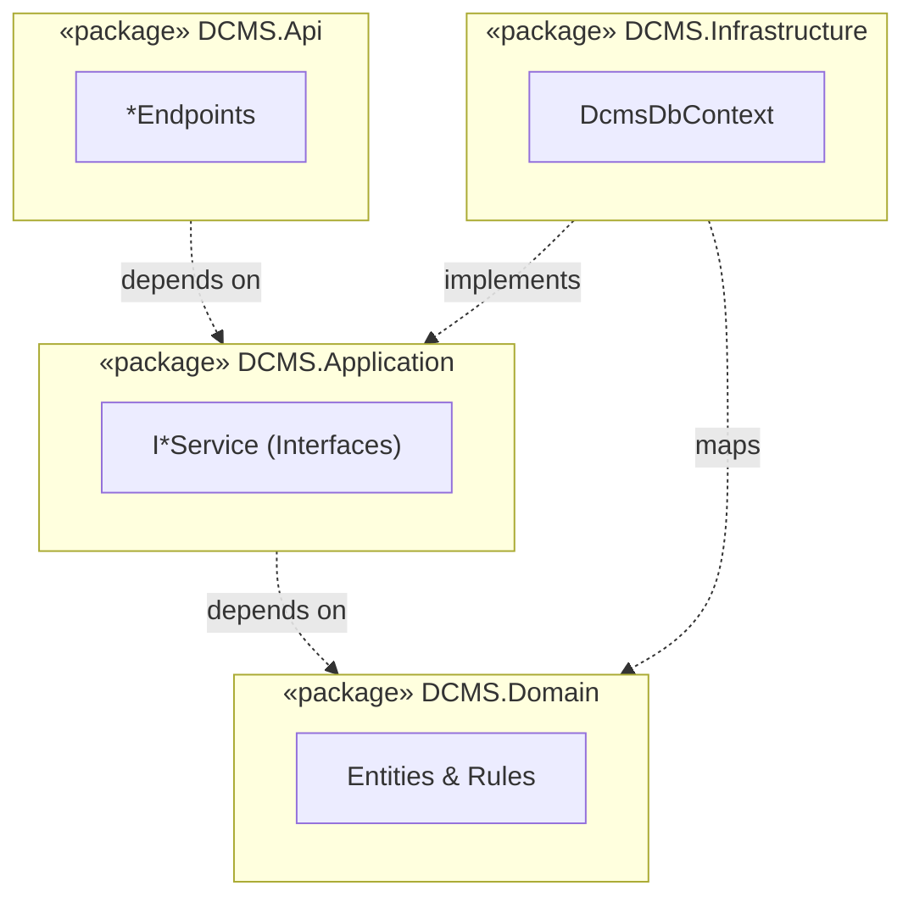
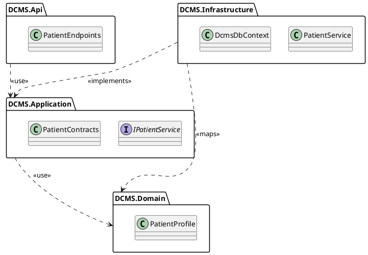

# Hướng dẫn chi tiết: Cách vẽ UML Package Diagram (Sơ đồ Gói)

Tài liệu này cung cấp phương pháp luận, quy chuẩn UML 2.5 và hướng dẫn thực hành từng bước để thiết kế và vẽ **UML Package Diagram (Sơ đồ Gói)** chuẩn xác cho các bài báo cáo kiến trúc phần mềm, đồ án tốt nghiệp (Capstone Project) và tài liệu kỹ thuật dự án (như DCMS).

---

## 1. Khái niệm & Mục đích của Package Diagram

### 1.1. Package Diagram là gì?
Trong UML (Unified Modeling Language), **Package Diagram (Sơ đồ gói)** là một loại sơ đồ cấu trúc tĩnh (**Structural Diagram**). Nó dùng để biểu diễn:
* Cách tổ chức mã nguồn hoặc hệ thống thành các nhóm logic (gọi là **Package / Gói** - tương ứng với Project, Namespace, Thư mục module).
* Mối quan hệ phụ thuộc (**Dependencies**) giữa các gói ở mức kiến trúc (Compile-time dependencies hoặc Runtime invocations).

### 1.2. Mục đích chính
1. **Kiểm soát độ phức tạp (Decomposition):** Một hệ thống lớn có hàng trăm class. Package diagram giúp gom các class có cùng trách nhiệm vào một khối để người đọc nắm bắt được kiến trúc cấp cao (High-level architecture).
2. **Thể hiện kiến trúc phân tầng (Layered / Clean Architecture):** Làm rõ ranh giới giữa tầng giao diện (Presentation), tầng nghiệp vụ (Application/Domain), và tầng kỹ thuật (Infrastructure/Database).
3. **Quản lý phụ thuộc & tránh lỗi kiến trúc:** Giúp phát hiện sớm các liên kết luẩn quẩn (Circular Dependencies) hoặc vi phạm nguyên lý đảo ngược phụ thuộc (Dependency Inversion Principle).

---

## 2. Ký hiệu chuẩn UML trong Package Diagram

Dưới đây là các ký hiệu chuẩn theo chuẩn **ISO/IEC 19505 (UML 2.5)**:

### 2.1. Biểu tượng Package (Gói)
Package được vẽ dưới dạng **chiếc cặp tài liệu / thư mục có tai (Tabbed Folder)**:
* **Tab nhỏ ở phía trên bên trái:** Dùng để ghi tên gói (nếu bên trong thân hiển thị các class/thành phần con) HOẶC ghi stereotype (`«subsystem»`, `«layer»`).
* **Khối chữ nhật lớn ở dưới:** Dùng để ghi tên gói (nếu không vẽ chi tiết class con bên trong) hoặc chứa danh sách các class/interface, sub-package.

```
       +--------------+
       | Package Name |
+------+--------------+-----------------------+
|                                             |
|  (Nội dung các class/sub-package bên trong) |
|                                             |
+---------------------------------------------+
```

### 2.2. Quan hệ Phụ thuộc (Dependency `..>`)
Ký hiệu: **Đường nét đứt với đầu mũi tên hở (`- - - >`)**
* **Ý nghĩa:** Gói A phụ thuộc vào gói B (Package A `..>` Package B) nghĩa là nếu gói B thay đổi (đổi interface, sửa signature, sửa logic), gói A có thể bị ảnh hưởng hoặc phải biên dịch lại.
* **Quy tắc chiều mũi tên (RẤT QUAN TRỌNG):**
  * **Mũi tên luôn xuất phát từ bên phụ thuộc (Client / Caller) và hướng về bên cung cấp dịch vụ (Supplier / Provider).**
  * *Ví dụ:* `DCMS.Api` gọi service của `DCMS.Application` $\rightarrow$ Mũi tên từ `DCMS.Api` trỏ vào `DCMS.Application`.

### 2.3. Các Stereotype phổ biến trên mũi tên phụ thuộc
* `«use»`: Gói nguồn sử dụng các định nghĩa (class, method, interface) trong gói đích. Đây là quan hệ mặc định phổ biến nhất.
* `«import»` (Public Import): Gói nguồn thêm các thành phần public của gói đích vào namespace của mình.
* `«access»` (Private Import): Tương tự import nhưng chỉ có tác dụng nội bộ trong gói nguồn.
* `«merge»`: Gộp định nghĩa gói.

---

## 3. Các nguyên lý thiết kế Package (Robert C. Martin - Clean Architecture)

Để vẽ được Package Diagram chuẩn, hệ thống cần tuân thủ 6 nguyên lý thiết kế gói (Component/Package Design Principles):

### 3.1. Các nguyên lý kết dính (Package Cohesion) - "Gom cái gì vào đâu?"
1. **REP (Release/Reuse Equivalency Principle):** Hạt nhân tái sử dụng chính là hạt nhân phát hành. Các class cùng được release theo một phiên bản thì nằm chung một package.
2. **CCP (Common Closure Principle):** Các class cùng thay đổi vì một lý do thì gom vào cùng một package. (Nguyên lý Đơn trách nhiệm - SRP ở mức Package).
3. **CRP (Common Reuse Principle):** Không bắt các class phụ thuộc vào những thứ mà chúng không sử dụng. Tránh việc gom các class không liên quan vào cùng một package.

### 3.2. Các nguyên lý ghép nối (Package Coupling) - "Phụ thuộc thế nào?"
1. **ADP (Acyclic Dependencies Principle) - BẮT BUỘC:** 
   * **Đồ thị phụ thuộc giữa các package TUYỆT ĐỐI KHÔNG ĐƯỢC CÓ CHU TRÌNH (No Cycles).**
   * Nếu có $A \rightarrow B \rightarrow C \rightarrow A$, hệ thống sẽ bị "thắt nút", không thể tái sử dụng hoặc kiểm thử riêng rẽ bất kỳ package nào.
2. **SDP (Stable Dependencies Principle):**
   * Chiều phụ thuộc phải hướng về phía có **độ ổn định cao hơn (Stability)**.
   * Gói Domain và Application là nơi chứa luật cốt lõi (ít thay đổi công nghệ) nên phải là nơi ổn định nhất, các gói dễ thay đổi (như UI, Framework, Database) phải phụ thuộc vào nó, chứ không được ngược lại.
3. **SAP (Stable Abstractions Principle):**
   * Một gói càng ổn định thì càng phải **trừu tượng (Abstract)** (chứa Interface, Abstract Class).
   * Ví dụ: `DCMS.Application` chứa toàn Interface (`IAccountService`, `IPatientService`), nên nó vừa ổn định vừa trừu tượng.

---

## 4. Phân tích bức ảnh mẫu thực tế

Nhìn lại bức ảnh mẫu UML Package Diagram trong câu hỏi của bạn:
* Các gói gồm: `member_authority`, `registration`, `fed_rpc`, `fed`, `mongo_db`, `fed_tool`, `util`, `registry`, `slide_authority`.
* **Quan sát 1 (Supplier/Utility):** Gói `util` và `mongo_db` nằm ở vị trí nhận rất nhiều mũi tên trỏ vào từ các gói khác. Điều này phản ánh đúng: các gói tiện ích dùng chung và gói cơ sở dữ liệu là các tầng dưới (Service/Resource Provider), các module nghiệp vụ đều phụ thuộc vào chúng.
* **Quan sát 2 (Dependency Arrow):** Tất cả các đường nối đều là **đường nét đứt mũi tên hở (`..>`)**, thể hiện rõ quan hệ phụ thuộc (Usage/Dependency).
* **Quan sát 3 (Tính phi chu trình - ADP):** Không có bất kỳ vòng tròn khép kín nào giữa các mũi tên (không có $A \rightarrow B \rightarrow A$).

---

## 5. Quy trình 5 bước vẽ Package Diagram từ mã nguồn dự án

### Bước 1: Xác định phạm vi và mức độ chi tiết (Level of Abstraction)
* **Overall Package Diagram (Mức hệ thống):** Thể hiện sự liên kết giữa các phân hệ (Web frontend, Mobile app, Backend API, Database, AI microservice).
* **Sub-system Package Diagram (Mức phân hệ):** Thể hiện chi tiết cấu trúc bên trong của một phân hệ (ví dụ: các tầng Clean Architecture trong Backend, hoặc các module trong Frontend).

### Bước 2: Liệt kê các Package dựa trên cấu trúc Code thực tế
* **Với Backend C# (.NET):** 
  * Mỗi Project `.csproj` là một package lớn (`DCMS.Api`, `DCMS.Application`, `DCMS.Infrastructure`, `DCMS.Domain`).
  * Mỗi Folder tính năng (Vertical Slice) hoặc Namespace là một sub-package (`Features.Patients`, `Features.Treatment`, `Features.Finance`).
* **Với Frontend (React / TypeScript):**
  * Thư mục `src/app`, `src/features/{feature}`, `src/services`, `src/components` tương ứng là các package.

### Bước 3: Xác định chiều mũi tên phụ thuộc (Inspect Code References)
* Mở các file cấu hình và code để xác định ai gọi ai:
  * Trong C#: Kiểm tra `<ProjectReference>` trong `.csproj` hoặc các câu lệnh `using DCMS.Application...`.
  * Trong TypeScript: Kiểm tra các câu lệnh `import { ... } from '../../services/api'`.
* **Quy tắc vẽ chiều mũi tên:** Nếu file trong Package A `import` hoặc `using` class từ Package B $\rightarrow$ Vẽ mũi tên từ **A** chỉ về **B** (`A ..> B`).

### Bước 4: Kiểm tra và khử vòng lặp phụ thuộc (DIP)
* Nếu phát hiện Package B cần dữ liệu từ Package A, nhưng Package A đã phụ thuộc Package B:
  * **Cách xử lý:** Áp dụng **Dependency Inversion Principle (DIP)**. Định nghĩa một `Interface` ở tầng giữa hoặc ở tầng Core (Application), để cả A và B cùng phụ thuộc vào Interface đó thay vì phụ thuộc trực tiếp vào nhau.

### Bước 5: Bổ sung các Package hỗ trợ (Testing & Cross-cutting)
* Thêm các package kiểm thử (`UnitTests`, `IntegrationTests`) và vẽ mũi tên từ package test trỏ vào các package code được kiểm thử.

---

## 6. Hướng dẫn cú pháp vẽ trên các công cụ

### 6.1. Vẽ bằng Mermaid (Dành cho Markdown, GitHub, Notion)
Mermaid dùng `flowchart TB` kết hợp `subgraph` và liên kết nét đứt `-.->`:



### 6.2. Vẽ bằng PlantUML (Chuẩn UML học thuật)
Trong PlantUML, từ khóa `package` hoặc `folder` được hỗ trợ nguyên bản:



### 6.3. Vẽ bằng Draw.io / MS Visio
1. Mở Draw.io $\rightarrow$ Chọn thư viện hình **UML** bên cột trái.
2. Kéo khối hình **Package** (hình thư mục có tai) vào canvas.
3. Đặt tên package ở góc trên hoặc chính giữa.
4. Dùng công cụ kết nối: Chọn kiểu đường **Dashed (Nét đứt)**, đầu mũi tên là **Open Arrow (`>`)**.
5. Nhấp đúp chuột lên đường mũi tên để thêm nhãn phụ thuộc (ví dụ: `«use»`, `«depends on»`).

---

## 7. Các lỗi sai phổ biến cần tuyệt đối tránh khi chấm điểm

| Lỗi sai thường gặp | Biểu hiện | Cách sửa đúng |
|---|---|---|
| **1. Vẽ ngược chiều mũi tên** | Nghĩ rằng *Database trả dữ liệu về cho Service* nên vẽ mũi tên từ Database $\rightarrow$ Service. | **Sai!** Service là bên gửi câu truy vấn, Service phụ thuộc vào Database. Mũi tên phải là Service $\rightarrow$ Database. |
| **2. Nhầm lẫn giữa Data Flow và Dependency** | Vẽ mũi tên thể hiện luồng dữ liệu (Dataflow) thay vì quan hệ phụ thuộc cấu trúc (Structural dependency). | Dependency diagram chỉ thể hiện *Code của ai phụ thuộc vào ai để compile hoặc chạy*, không vẽ luồng dữ liệu nghiệp vụ. |
| **3. Dùng sai nét vẽ** | Dùng nét liền có mũi tên tam giác đặc (`--->`) (đây là quan hệ Kế thừa / Generalization). | Quan hệ giữa các Package **bắt buộc phải là nét đứt mũi tên hở (`..>`)**. |
| **4. Xuất hiện vòng lặp (Cycles)** | Package A trỏ vào B, B lại trỏ ngược về A. | Tách các class dùng chung ra một package `Common` hoặc đưa Interface lên tầng `Application`. |
| **5. Gom gói vô tội vạ ("God Package")** | Nhét toàn bộ tiện ích, controller, database vào một package `Common` khổng lồ. | Tách nhỏ thành các gói chuyên biệt theo đúng nguyên lý SRP và CCP. |

