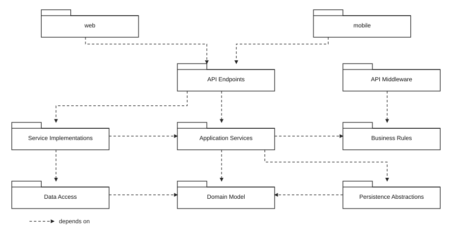
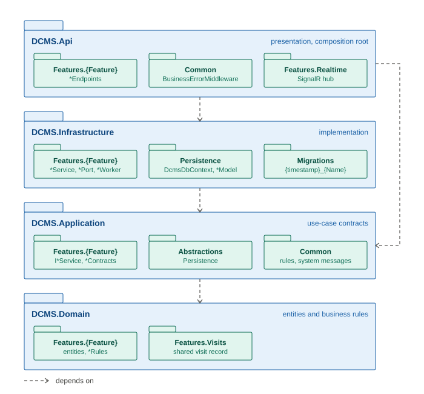
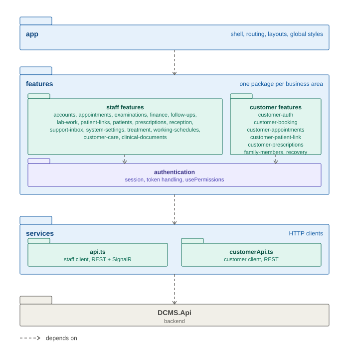
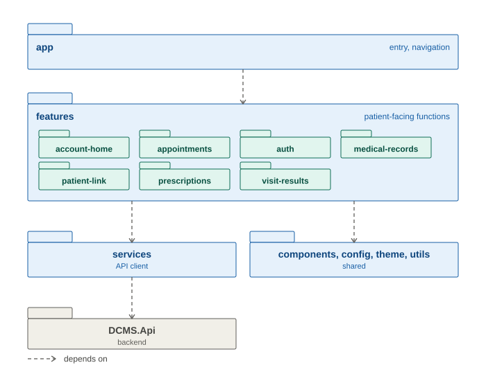

# 2. Package Diagram

DCMS (Dental Clinic Management System) has three delivered sub-systems and one planned one. This section gives the package diagram of each, the responsibility of every package, and the package/class naming conventions. It is derived from the source tree (`backend/`, `web/`, `mobile/`) and the project files, not from a plan.

| Sub-system | Technology | Location | Status |
|---|---|---|---|
| Backend API | .NET 10, ASP.NET Core Web API, EF Core + Npgsql, ASP.NET Core Identity, SignalR | `backend/` | Delivered |
| Web application (staff and customer) | React, TypeScript, Vite, Ant Design | `web/` | Delivered |
| Mobile application (patient) | Expo (React Native), TypeScript | `mobile/` | Scaffolded |
| AI service (X-ray analysis) | FastAPI, YOLO | not in repository | Planned (phase 2) |

## 2.1 Overall package diagram

UML package notation: a tabbed box is a package, a dashed arrow means "depends on" (compile-time).

The arrows are compile-time dependencies. `DCMS.Domain` depends on nothing. `DCMS.Application` depends only on `DCMS.Domain`. `DCMS.Infrastructure` implements the contracts declared in `DCMS.Application`. `DCMS.Api` is the composition root: it references `DCMS.Application` and `DCMS.Infrastructure` and wires them together in `Program.cs` and `DependencyInjection.cs`.

## 2.2 Backend API

### 2.2.1 Layer diagram

UML package notation: a tabbed box is a package, a dashed arrow means "depends on" (compile-time).

### 2.2.2 Packages and responsibilities

| Package (project) | Responsibility | Depends on |
|---|---|---|
| `DCMS.Domain` | Entities, value objects and business invariants (for example `PatientProfile`, `TreatmentDossier`, `DossierPayment`, `TreatmentPlanRules`). Pure C#, no framework or database code. | none |
| `DCMS.Application` | Use-case boundary: service interfaces (`IAccountService`), request/response DTOs and ports (`*Contracts.cs`), shared rules and Vietnamese system messages (`Common`), and persistence abstractions (`Abstractions/Persistence`). | Domain |
| `DCMS.Infrastructure` | Implements Application contracts: services that use EF Core, `DcmsDbContext` and the entity models in `Persistence`, migrations, e-mail delivery (MailKit), PayOS gateway, antivirus scanning, background workers, and the development seeders. | Application (and, through it, Domain) |
| `DCMS.Api` | HTTP surface: minimal-API endpoint groups per feature, authentication/authorization setup, `BusinessErrorMiddleware` (maps business errors to HTTP responses), the SignalR notification hub, and `Program.cs` composition. | Application, Infrastructure |

Tests: `backend/tests/DCMS.UnitTests` (domain and rule tests), `backend/tests/DCMS.IntegrationTests` (API against an isolated PostgreSQL schema). Tools: `backend/tools/DCMS.ReceptionE2E` (builds the isolated E2E fixture).

### 2.2.3 Feature packages

Each layer is split by the same feature folders ("vertical slices" inside horizontal layers). A feature exists in a layer only when that layer has something to say about it.

| Feature package | Business area | Domain | Application | Infrastructure | Api |
|---|---|:-:|:-:|:-:|:-:|
| `Accounts` | Staff accounts, roles | x | x | x | x |
| `Authentication` | Sign-in, tokens, recovery | x | x | x | x |
| `Scheduling` | Branches, chairs, working schedules, booking settings | x | x | x | x |
| `Appointments` | Booking, change, cancel, no-show | x | x | x | x |
| `Reception` | Check-in, queue | | x | x | x |
| `Patients` | Patient master data | x | x | x | x |
| `PatientLinks` | Account-to-patient links | x | x | x | x |
| `FamilyMembers` | Relatives and delegated record access | x | x | x | x |
| `Examinations` | Examination, diagnoses, investigations, clinical documents | x | x | x | x |
| `Prescriptions` | Prescriptions and templates | x | x | x | x |
| `Visits` | Visit record shared by examination, treatment and billing | x | | | |
| `Treatment` | Dossiers, plans, sheets, lab orders, PayOS, care tasks | x | x | x | x |
| `Finance` | Payments, advances, refunds, revenue | x | x | x | x |
| `SystemSettings` | Reference catalogs, materials, purchases, access groups | x | x | x | x |
| `Settings` | General configuration, branch profile | x | x | x | x |
| `Notifications` | Notifications and reminders | | x | x | x |
| `SupportRequests` | Customer support inbox (contracts only; endpoints are `SupportRequestEndpoints` in `Api/Features/Appointments`, implementation in `Infrastructure/Features/Appointments`) | | x | | |
| `Realtime` | SignalR hub and notifier | | | | x |
| `Health` | Health endpoint | | | | x |

### 2.2.4 Package dependency rules

1. A layer may reference only the layers shown in the diagram. `Domain` never references another DCMS project.
2. A feature package may use the `Common`/`Abstractions` packages of its own layer, and may reference another feature only through that feature's contracts in `DCMS.Application`, never through its `Infrastructure` classes.
3. Only `DCMS.Infrastructure` references EF Core, Npgsql, Identity, MailKit and HTTP clients. Endpoints never touch `DcmsDbContext`.
4. Cross-feature calls inside `Infrastructure` go through ports (`*Port`), for example `FollowUpAppointmentPort`, `ClinicalPostingPorts`.
5. Business errors are raised in services and translated once, in `BusinessErrorMiddleware`.

### 2.2.5 Naming conventions (backend)

| Item | Convention | Example |
|---|---|---|
| Project | `DCMS.{Layer}` | `DCMS.Infrastructure` |
| Namespace | `DCMS.{Layer}.Features.{Feature}` (layer-level shared code: `DCMS.{Layer}.Common`, `DCMS.Application.Abstractions.*`) | `DCMS.Domain.Features.Patients` |
| Feature folder | PascalCase, plural business noun, identical in every layer | `Treatment`, `Patients` |
| Endpoint group | `{Subject}Endpoints` (static class, one `Map...` method per group) | `ItemPlanEndpoints`, `PatientEndpoints` |
| DTOs and ports | one or more `{Subject}Contracts.cs` files per feature in Application | `DossierPaymentContracts.cs` |
| Service interface / implementation | `I{Name}Service` in Application, `{Name}Service` in Infrastructure | `IAccountService` |
| Port | `I{Name}Port` in Application, `{Name}Port` in Infrastructure | `FollowUpAppointmentPort` |
| Domain entity | singular noun, file named after the main entity; rule holders end with `Rules` | `TreatmentDossier.cs`, `TreatmentPlanRules.cs` |
| Background work | `{Name}Worker`, `{Name}Scanner` | `PayOsOrderWorker`, `TreatmentDueScanner` |
| External gateway | `{Provider}Gateway` | `PayOsGateway` |
| EF model | `{Area}Model.cs` in `Persistence`; migrations `{timestamp}_{Name}` | `FinanceModel.cs` |
| Development data | `Development{Name}Seeder`, run only in the Development environment | `DevelopmentAccountSeeder` |
| Database objects | tables and columns in upper snake case / PascalCase as mapped in `*Model.cs` | `SCHEDULING_SERVICE` |
| Test classes | `{Subject}Tests` | `DomainRulesTests` |

### 2.2.6 Class naming per package (backend)

| Package | Class / file naming | Examples |
|---|---|---|
| `DCMS.Api/Features/{Feature}` | `{Subject}Endpoints` static class with a `Map...` method | `PatientEndpoints`, `ItemPlanEndpoints` |
| `DCMS.Api/Common` | `{Purpose}Middleware` | `BusinessErrorMiddleware` |
| `DCMS.Api/Features/Realtime` | `{Name}Hub`, `{Name}Notifier` | SignalR notification hub |
| `DCMS.Application/Features/{Feature}` | `I{Name}Service`, `I{Name}Port`; DTO records in `{Subject}Contracts.cs` | `IAccountService`, `DossierPaymentContracts.cs` |
| `DCMS.Application/Abstractions` | `I{Name}` persistence abstractions | `Persistence` interfaces |
| `DCMS.Application/Common` | `{Name}Rules`, `SystemMessages` | `ContactRules` |
| `DCMS.Infrastructure/Features/{Feature}` | `{Name}Service`, `{Name}Port`, `{Name}Worker`, `{Name}Scanner`, `{Provider}Gateway`, `Development{Name}Seeder` | `PayOsGateway`, `TreatmentDueScanner` |
| `DCMS.Infrastructure/Persistence` | `DcmsDbContext`; `{Area}Model.cs` (entity mappings) | `FinanceModel.cs` |
| `DCMS.Infrastructure/Migrations` | `{timestamp}_{Name}` generated by EF Core | `20260101000000_AddX` |
| `DCMS.Domain/Features/{Feature}` | singular entity class per file; `{Name}Rules` for invariants | `TreatmentDossier`, `TreatmentPlanRules` |
| `DCMS.UnitTests` | `{Subject}Tests` | `DomainRulesTests` |

## 2.3 Web application

The web application is one React single-page application with two separate entry areas: the **staff workspace** (clinic staff, route tree under `/`) and the **customer portal** (patients and relatives, route tree under `/customer`).

UML package notation: a tabbed box is a package, a dashed arrow means "depends on" (compile-time).

| Package | Responsibility |
|---|---|
| `app` | Application shell, route definitions, staff workspace layout, global and shell styles. |
| `features/{feature}` | Everything for one business area: pages, drawers/modals, forms, local types and CSS. Features do not import each other's internals; shared needs go through `services` or `authentication`. |
| `features/authentication` | Sign-in state, token handling and the `usePermissions` hook that drives menu and button visibility. |
| `services` | HTTP clients, request-key handling, error mapping. Features call the API only through them. |
| `components`, `layouts`, `routes` | Shared UI parts, layouts and route helpers (currently placeholders with README files). |
| `unit` | Vitest unit tests. End-to-end tests live in `web/tests` (Playwright). |

Class and file naming per package (web): `app` holds `App.tsx` and `StaffWorkspace.tsx`; `features/{feature}` holds `{Subject}Page.tsx`, `{Subject}Modal.tsx` / `{Subject}Drawer.tsx`, `{subject}Types.ts` and one CSS file; `services` holds `api.ts` and `customerApi.ts`.

Naming conventions (web): feature folders are lower-case kebab-case and mirror backend features where one exists (`system-settings`, `follow-ups`); React components and pages are PascalCase files (`TreatmentSheet.tsx`, `AccountsPage.tsx`); page entry components end with `Page`, overlays with `Modal` or `Drawer`; type files are camelCase `*Types.ts` or `types.ts`; hooks start with `use`; CSS files are camelCase named after the feature or component (`itemPlans.css`); Playwright specs are `{subject}.spec.ts`, and specs that need an isolated API and database end with `.integration.spec.ts`.

## 2.4 Mobile application (patient)

UML package notation: a tabbed box is a package, a dashed arrow means "depends on" (compile-time).

The mobile app mirrors the web feature layout and exposes only patient-facing functions (own record, appointments, prescriptions, visit results, patient link). Naming follows the web conventions: kebab-case feature folders, PascalCase components, `use*` hooks.

## 2.5 AI service (planned, phase 2)

No code exists yet. The agreed boundary is a separate FastAPI service that receives an X-ray image reference from `DCMS.Api` and returns detection results. It will be added as its own package (`ai/`) with an adapter in `DCMS.Infrastructure/Features/Examinations`, keeping the dependency direction unchanged. Model weights stay outside Git.

## 2.6 Cross-cutting packages

| Concern | Where it lives |
|---|---|
| Authentication and authorization | `DCMS.Api` (JWT bearer setup, per-endpoint policies), `DCMS.Infrastructure/Features/Authentication`, web `features/authentication` |
| Dynamic permissions | `DCMS.Infrastructure/Features/SystemSettings` (access groups), web `features/system-settings` |
| Real-time notifications | `DCMS.Api/Features/Realtime` (SignalR hub), web `support-inbox` realtime client |
| Persistence and migrations | `DCMS.Infrastructure/Persistence` |
| Error translation | `DCMS.Api/Common/BusinessErrorMiddleware.cs` |
| Development data | `Development*Seeder` classes, `infrastructure/seed`, `infrastructure/scripts` |
| Infrastructure as code | `infrastructure/docker/compose.yaml` (PostgreSQL, ClamAV, Mailpit) |
