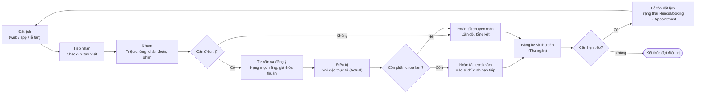
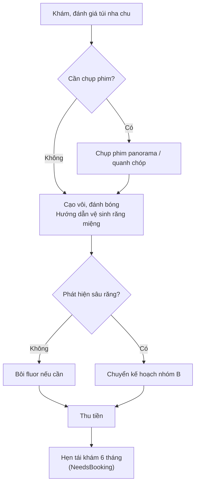
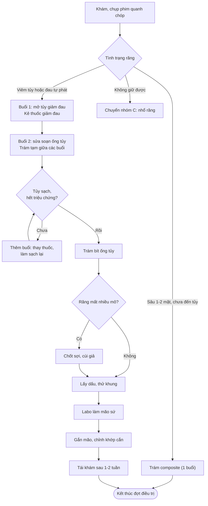
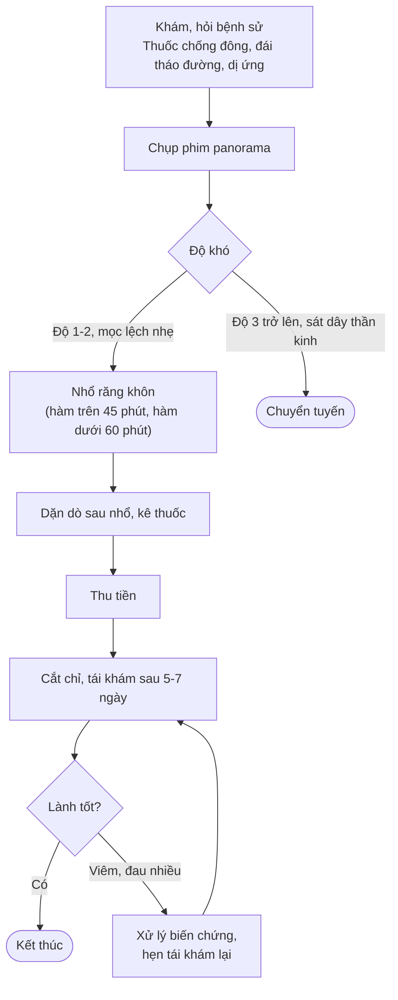
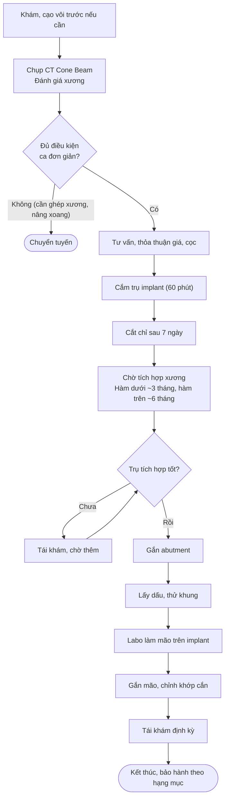
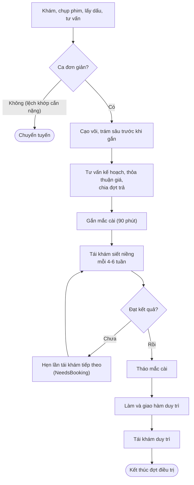

# Phạm vi dịch vụ và sơ đồ quy trình điều trị

Ngày cập nhật: **25/11/2026**. Dịch vụ, số buổi và thời lượng lấy từ catalog mẫu (`DevelopmentTreatmentCatalogSeeder`, nguồn trong [TREATMENT-CATALOG-SEED.md](TREATMENT-CATALOG-SEED.md)); luồng chung theo [CLINIC-FLOW-DCMS-110.vi.md](CLINIC-FLOW-DCMS-110.vi.md).

> **Trạng thái:** bản nháp theo catalog và tài liệu tham khảo. **Chưa có bác sĩ xác nhận.** Số buổi, khoảng cách tái khám và danh sách ca không nhận cần được bác sĩ rà lại trước khi dùng làm cam kết nghiệp vụ.

## 1. Quy mô phòng khám

Phòng khám nha khoa cỡ nhỏ và vừa, theo xác nhận trong DCMS-110: **3 ghế vật lý**, nhiều nha sĩ làm cùng ca, ghế là sức chứa của chi nhánh (xem [CHAIR-CAPACITY-ANY-DENTIST-BOOKING.vi.md](CHAIR-CAPACITY-ANY-DENTIST-BOOKING.vi.md)). Phòng khám làm các ca **đơn giản đến trung bình**; ca khó chuyển tuyến sang bệnh viện hoặc phòng khám chuyên khoa.

## 2. Năm nhóm dịch vụ

| Nhóm | Dịch vụ thực hiện (theo catalog) | Không nhận (chuyển tuyến) |
| --- | --- | --- |
| **A. Khám và phòng ngừa** | Khám, chụp phim panorama / quanh chóp / CT Cone Beam, cạo vôi (thường và nhiều), bôi fluor, trám bít hố rãnh, điều trị ê buốt, nha khoa trẻ em (trám răng sữa, nhổ răng sữa, lấy tủy răng sữa), tẩy trắng tại nhà và tại ghế | Gây mê toàn thân cho trẻ không hợp tác |
| **B. Phục hồi và nội nha** | Trám GIC / composite / thẩm mỹ, hàn cổ răng, đóng khe thưa, mở tủy giảm đau, điều trị tủy răng 1 chân / hàm nhỏ / hàm lớn, chốt sợi và cùi giả, nạo túi nha chu (túi không quá 5 mm), cắt lợi trùm | Chữa tủy lại ca ống tủy canxi hóa, gãy dụng cụ trong ống tủy; phẫu thuật cắt chóp |
| **C. Phẫu thuật răng miệng** | Nhổ răng đơn giản, nhổ răng khôn hàm trên và hàm dưới độ 1–2, rạch dẫn lưu áp xe lợi khu trú, cắt chỉ và tái khám sau nhổ | Răng khôn mọc ngầm sát dây thần kinh (độ 3 trở lên), u nang, phẫu thuật hàm mặt, bệnh nhân rối loạn đông máu chưa được kiểm soát |
| **D. Phục hình và Implant** | Mão sứ kim loại / Titanium / Zirconia / Emax, cầu răng sứ, inlay/onlay, veneer, hàm tháo lắp nhựa và khung kim loại, implant ca đơn giản (cắm trụ, abutment, mão trên implant) | Ghép xương lớn, nâng xoang phức tạp, implant toàn hàm |
| **E. Chỉnh nha (niềng răng)** | Niềng mắc cài kim loại ca đơn giản, tái khám siết niềng, hàm duy trì sau niềng | Ca lệch khớp cắn nặng, cần phẫu thuật hàm; niềng trong suốt phức tạp |

Mỗi dịch vụ trong catalog có đơn vị tính, **thời lượng công khai** (phút) và **giá tham chiếu**; thời lượng quyết định độ dài lịch hẹn khi đặt (xem [CLINIC-SLOTS-AND-SERVICE-DURATIONS.vi.md](CLINIC-SLOTS-AND-SERVICE-DURATIONS.vi.md)).

## 3. Luồng chung cho mọi ca

Mọi dịch vụ đều đi qua cùng một khung. Khác biệt giữa các nhóm nằm ở **bước Điều trị** (số buổi, labo, thời gian chờ), trình bày ở mục 4.

Ghi chú nghiệp vụ:
- **Visit** là một lần đến; một lịch hẹn hợp lệ tạo tối đa một Visit. **Đợt điều trị** có nhiều hạng mục, đi qua nhiều Visit.
- Tiến độ chuyên môn không đồng nghĩa số tiền đã trả; có thể cọc và trả nhiều đợt.
- Khách chưa có lịch dùng xếp lịch nhanh (walk-in) rồi check-in.
- Khi đặt lịch hệ thống kiểm tra ghế trống và nha sĩ đang trong ca; hết ghế hoặc nha sĩ bận thì báo chọn giờ khác.

## 4. Sơ đồ theo từng nhóm

### 4.1 Nhóm A: Khám và phòng ngừa (ví dụ cạo vôi, duy trì 6 tháng)

Thường **1 buổi**, 40–60 phút. Tái khám 2–4 tuần nếu viêm lợi, sau đó 6 tháng một lần (3–4 tháng nếu có bệnh nha chu).

Nha khoa trẻ em đi theo luồng tương tự: khám và hướng dẫn phụ huynh, trám răng sữa 1–2 buổi (25 phút mỗi răng), chỉ lấy tủy răng sữa khi viêm tủy, bôi fluor, tái khám 3–6 tháng.

### 4.2 Nhóm B: Phục hồi và nội nha (ví dụ điều trị tủy rồi bọc mão)

Nội nha cần **nhiều buổi**: mở tủy, làm sạch và trám bít ống tủy (2–3 buổi với răng hàm lớn), rồi phục hồi bằng cùi và mão. Mão cần labo.

Mốc thời lượng theo catalog: tủy răng 1 chân 60 phút, hàm nhỏ 75 phút, hàm lớn 90 phút.

### 4.3 Nhóm C: Phẫu thuật răng miệng (ví dụ nhổ răng khôn)

Thường **1 buổi nhổ** và **1 buổi cắt chỉ** sau 5–7 ngày. Chụp phim trước để đánh giá hướng mọc và vị trí so với dây thần kinh.

Nhánh khác của nhóm: rạch dẫn lưu áp xe lợi khu trú (30 phút) khi đau cấp, rồi tái khám sau 24–48 giờ và vào kế hoạch điều trị tủy hoặc nhổ răng. Nhổ răng không giữ được thì chờ lành thương 4–8 tuần rồi chuyển sang nhóm D (implant, cầu răng, hàm tháo lắp).

### 4.4 Nhóm D: Phục hình và Implant (ví dụ implant đơn lẻ)

Quy trình **dài nhất trong nhóm cấy ghép**, vì phải chờ trụ tích hợp xương: khoảng 3 tháng ở hàm dưới, 6 tháng ở hàm trên. Trong thời gian chờ không có buổi điều trị; hệ thống dùng chỉ định hẹn tiếp (`NeedsBooking`) cho mốc quay lại.

Các dịch vụ khác của nhóm đi ngắn hơn:
- **Cầu răng sứ:** mài 2 răng trụ và gắn cầu tạm, lấy dấu, thử khung, gắn cầu, tái khám sau 1–2 tuần. Giá tính 3 đơn vị (2 trụ và 1 răng thay).
- **Hàm tháo lắp:** khoảng 3 buổi lấy dấu sơ khởi, dấu cá nhân, ghi khớp cắn, thử răng sáp; giao hàm; chỉnh đau 1–2 lần.
- **Mão, veneer, inlay/onlay:** mài răng, lấy dấu, labo, gắn, tái khám.

### 4.5 Nhóm E: Chỉnh nha (niềng mắc cài kim loại, ca đơn giản)

Điều trị **dài hạn 18–24 tháng**: một buổi gắn mắc cài (90 phút), sau đó tái khám siết niềng 4–6 tuần một lần (khoảng 18–24 lần), cuối cùng tháo mắc cài và đeo hàm duy trì.

Đây là nhóm có **nhiều Visit nhất trên một hạng mục**, nên thu tiền theo nhiều đợt và theo dõi tiến độ tách khỏi số tiền đã trả.

## 5. Đối chiếu với chức năng DCMS

| Bước | Chức năng đã có | Ghi chú / chưa có |
| --- | --- | --- |
| Đặt lịch | Đặt lịch khách hàng (web, app), "Bất kỳ nha sĩ", kiểm tra ghế và lịch làm việc | Chưa quản lý **máy điều trị** (X-quang, CT) như một tài nguyên riêng; chỉ có ghế |
| Tiếp nhận | Reception, check-in, hàng chờ | |
| Khám | Màn hình khám, odontogram, AI phát hiện sâu răng (tùy chọn) | |
| Tư vấn / kế hoạch | Kế hoạch điều trị mẫu theo catalog (15+ kế hoạch), giá thỏa thuận, giảm giá theo quyền | Kế hoạch mẫu chưa có sơ đồ trực quan trên giao diện |
| Điều trị | Ghi Actual, tiến độ hạng mục, đơn thuốc | |
| Labo | Quản lý công việc labo, chuyển trạng thái | |
| Thu tiền | Thu nhiều đợt, cọc, QR PayOS, hoàn tiền | |
| Hẹn tiếp | `NeedsBooking`, nhắc lịch 24 giờ và 2 giờ | |
| Báo cáo | Thống kê công việc/dịch vụ, thống kê tài chính cho chủ phòng khám | Chưa có báo cáo khám bệnh tổng hợp |

## 6. Việc cần bác sĩ xác nhận

1. Số buổi và khoảng cách tái khám cho từng nhóm (mục 4) có đúng với thực tế phòng khám không.
2. Danh sách **ca không nhận** ở mục 2 (đặc biệt độ khó răng khôn, điều kiện implant ca đơn giản).
3. Thời gian chờ tích hợp xương implant và thời gian lành thương sau nhổ.
4. Có cung cấp thêm nhóm nào khác không (ví dụ niềng trong suốt, bọc răng toàn hàm, nha chu nâng cao).

Người xác nhận: ………………  Ngày: ………………
